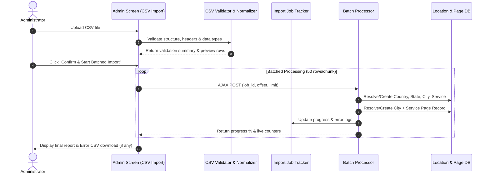

# SEO City Pages — CSV Import Specification & Architecture

## 1. Overview

The **CSV Import System** is the primary, high-volume data-ingestion pipeline for the **SEO City Pages** plugin. Instead of manually creating individual Countries, States, Cities, and Services one by one, administrators upload a CSV spreadsheet which automatically normalizes, resolves, and registers location and service records along with their logical `City + Service` page combinations.

---

## 2. Required CSV Structure

The CSV parser expects four logical columns:

```csv
country,state,city,service
```

### Sample CSV Payload:
```csv
country,state,city,service
India,Gujarat,Rajkot,SEO Agency
India,Gujarat,Ahmedabad,SEO Agency
India,Gujarat,Surat,SEO Agency
India,Maharashtra,Mumbai,Digital Marketing Agency
India,Gujarat,Rajkot,Web Development
```

### Column Matching & Tolerance Rules:
- **Case-Insensitive Headers**: `country`, `Country`, `COUNTRY`, ` country ` all resolve to the logical `country` field.
- **Column Order Agnostic**: The columns can appear in any order in the CSV file.
- **Extra Columns Ignored**: Unrecognized columns (such as notes or postal codes) are safely ignored without breaking ingestion.
- **Strict Requirement**: Missing any of the 4 required headers (`country`, `state`, `city`, `service`) immediately halts validation with an explicit error.

---

## 3. Ingestion Lifecycle



---

## 4. Normalization & Deduplication Rules

1. **Normalized Comparison Keys**:
   - Comparison keys use `trim()`, internal whitespace collapsing (replacing multiple spaces/tabs with single space), and `strtolower()`.
   - Stored values preserve canonical human-readable display casing.
2. **In-CSV Duplicate Detection**:
   - Duplicate rows appearing multiple times within the same CSV are detected during initial validation.
   - The first occurrence is validated for processing; subsequent identical rows are flagged as `duplicate_in_csv` and skipped.
3. **Idempotent Re-Import**:
   - Uploading the same CSV again will find all existing Countries, States, Cities, Services, and City + Service page combinations, creating **0 duplicate records**.

---

## 5. Large CSV Support & Batch Processing

- **Chunked Processing**: Rows are processed in batches (default: 50 rows per batch) via AJAX requests to prevent PHP execution timeouts and memory exhaustion.
- **In-Memory Lookup Cache**: During a batch run, previously resolved countries, states, cities, and services are cached in memory to eliminate N+1 database queries.
- **Import Job Concept**: Each session creates an import job tracking record in `wp_seo_import_jobs`:
  - `job_id`: Unique UUID identifier.
  - `total_rows`, `processed_rows`, `created_countries`, `created_states`, `created_cities`, `created_services`, `created_combinations`, `existing_combinations`, `failed_rows`.
  - `status`: `pending` $\rightarrow$ `ready` $\rightarrow$ `processing` $\rightarrow$ `completed` / `completed_errors`.
  - `errors_summary`: Detailed error messages per row for downloadable error reporting.

---

## 6. Security Controls

- **Capability Enforcement**: All import operations require `Capabilities::MANAGE` (`manage_seo_city_pages`).
- **CSRF & Nonce Protection**: File uploads and AJAX requests require valid nonces.
- **File Validation**: Enforces `.csv` extension, MIME type verification, and maximum upload file size (`wp_max_upload_size()`).
- **Isolated Storage**: Uploaded temporary files are placed in `wp-content/uploads/seo-city-pages-imports/` with randomized unique names and protected with `.htaccess` and `index.php`.
- **CSV Formula Injection Prevention**: Exported cells starting with `=`, `+`, `-`, `@`, `\t`, or `\r` are sanitized by prepending a single quote (`'`) via `Security::sanitize_csv_cell()`.
