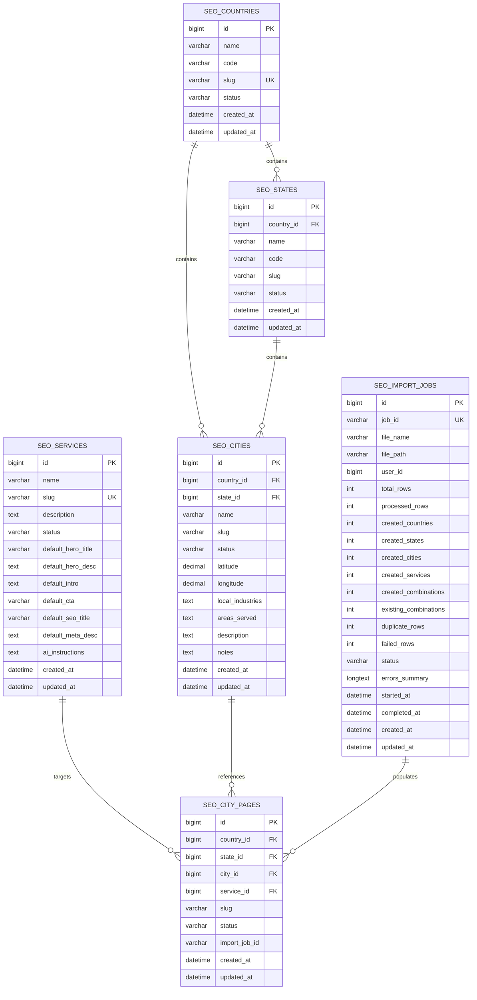

# SEO City Pages — Data Model Specification

## 1. Overview & Architecture

The **SEO City Pages** plugin manages geographic location hierarchies, service definitions, import job tracking, and logical city/service page combinations in dedicated custom database tables rather than standard WordPress taxonomies or post types. This decision ensures:
- Ultra-fast indexed queries at scale (tens of thousands of cities/locations).
- No post meta overhead (`wp_postmeta` sprawl).
- Strict referential integrity and dependency enforcement in the repository layer.
- Clean separation between core location/service entities, import job tracking, and generated landing page posts.

---

## 2. Entity Relational Diagram

---

## 3. Schema Specifications

### 3.1 Table: `{prefix}seo_countries`
Stores top-level nations (e.g., India, United States, United Kingdom).

| Column | Type | Nullable | Default | Description |
| :--- | :--- | :--- | :--- | :--- |
| `id` | `BIGINT(20) UNSIGNED` | No | `AUTO_INCREMENT` | Primary Key. |
| `name` | `VARCHAR(100)` | No | | Full name (e.g., "India", "United States"). |
| `code` | `VARCHAR(10)` | No | `''` | ISO-2/3 country code (e.g., "IN", "US"). |
| `slug` | `VARCHAR(100)` | No | | URL-safe unique slug (e.g., "india"). |
| `status` | `VARCHAR(20)` | No | `'active'` | Status: `'active'` or `'inactive'`. |
| `created_at` | `DATETIME` | No | | Creation timestamp (UTC). |
| `updated_at` | `DATETIME` | No | | Last modified timestamp (UTC). |

**Indexes:**
- `PRIMARY KEY (id)`
- `KEY idx_slug (slug)`
- `KEY idx_status (status)`

---

### 3.2 Table: `{prefix}seo_states`
Stores state/province/region entities linked to a parent country.

| Column | Type | Nullable | Default | Description |
| :--- | :--- | :--- | :--- | :--- |
| `id` | `BIGINT(20) UNSIGNED` | No | `AUTO_INCREMENT` | Primary Key. |
| `country_id` | `BIGINT(20) UNSIGNED` | No | | Parent country reference ID. |
| `name` | `VARCHAR(100)` | No | | State/region name (e.g., "Gujarat", "California"). |
| `code` | `VARCHAR(20)` | No | `''` | State abbreviation/code (e.g., "GJ", "CA"). |
| `slug` | `VARCHAR(100)` | No | | URL-safe slug within country (e.g., "gujarat"). |
| `status` | `VARCHAR(20)` | No | `'active'` | Status: `'active'` or `'inactive'`. |
| `created_at` | `DATETIME` | No | | Creation timestamp (UTC). |
| `updated_at` | `DATETIME` | No | | Last modified timestamp (UTC). |

**Indexes:**
- `PRIMARY KEY (id)`
- `KEY idx_country_id (country_id)`
- `KEY idx_slug (slug)`
- `KEY idx_status (status)`

---

### 3.3 Table: `{prefix}seo_cities`
Stores municipal city/town locations linked to a parent state and country.

| Column | Type | Nullable | Default | Description |
| :--- | :--- | :--- | :--- | :--- |
| `id` | `BIGINT(20) UNSIGNED` | No | `AUTO_INCREMENT` | Primary Key. |
| `country_id` | `BIGINT(20) UNSIGNED` | No | | Parent country reference ID. |
| `state_id` | `BIGINT(20) UNSIGNED` | No | | Parent state reference ID. |
| `name` | `VARCHAR(100)` | No | | City name (e.g., "Rajkot", "Mumbai"). |
| `slug` | `VARCHAR(100)` | No | | URL-safe slug within state (e.g., "rajkot"). |
| `status` | `VARCHAR(20)` | No | `'active'` | Status: `'active'` or `'inactive'`. |
| `latitude` | `DECIMAL(10, 7)` | Yes | `NULL` | Geographic latitude (-90.0000000 to +90.0000000). |
| `longitude` | `DECIMAL(10, 7)` | Yes | `NULL` | Geographic longitude (-180.0000000 to +180.0000000). |
| `local_industries` | `TEXT` | Yes | `NULL` | Comma-separated or newline-delimited industries. |
| `areas_served` | `TEXT` | Yes | `NULL` | Neighborhoods, suburbs, or postal clusters. |
| `description` | `TEXT` | Yes | `NULL` | Editorial notes / rich city background text. |
| `notes` | `TEXT` | Yes | `NULL` | Internal admin/staff notes. |
| `created_at` | `DATETIME` | No | | Creation timestamp (UTC). |
| `updated_at` | `DATETIME` | No | | Last modified timestamp (UTC). |

**Indexes:**
- `PRIMARY KEY (id)`
- `KEY idx_country_id (country_id)`
- `KEY idx_state_id (state_id)`
- `KEY idx_slug (slug)`
- `KEY idx_status (status)`

---

### 3.4 Table: `{prefix}seo_services`
Stores service offerings and default dynamic content blueprints.

| Column | Type | Nullable | Default | Description |
| :--- | :--- | :--- | :--- | :--- |
| `id` | `BIGINT(20) UNSIGNED` | No | `AUTO_INCREMENT` | Primary Key. |
| `name` | `VARCHAR(150)` | No | | Service title (e.g., "SEO Agency"). |
| `slug` | `VARCHAR(150)` | No | | URL-safe slug (e.g., "seo-agency"). |
| `description` | `TEXT` | Yes | `NULL` | Service overview / summary. |
| `status` | `VARCHAR(20)` | No | `'active'` | Status: `'active'` or `'inactive'`. |
| `default_hero_title` | `VARCHAR(255)` | Yes | `NULL` | Template blueprint: Hero Heading. |
| `default_hero_desc` | `TEXT` | Yes | `NULL` | Template blueprint: Hero Subtitle. |
| `default_intro` | `TEXT` | Yes | `NULL` | Template blueprint: Section Intro text. |
| `default_cta` | `VARCHAR(255)` | Yes | `NULL` | Template blueprint: Call to Action text. |
| `default_seo_title` | `VARCHAR(255)` | Yes | `NULL` | Template blueprint: SEO Title tag. |
| `default_meta_desc` | `TEXT` | Yes | `NULL` | Template blueprint: Meta Description. |
| `ai_instructions` | `TEXT` | Yes | `NULL` | Prompt guidance for AI content generation. |
| `created_at` | `DATETIME` | No | | Creation timestamp (UTC). |
| `updated_at` | `DATETIME` | No | | Last modified timestamp (UTC). |

**Indexes:**
- `PRIMARY KEY (id)`
- `KEY idx_slug (slug)`
- `KEY idx_status (status)`

---

### 3.5 Table: `{prefix}seo_import_jobs`
Tracks CSV upload sessions, batch progress, statistics, and error summaries.

| Column | Type | Nullable | Default | Description |
| :--- | :--- | :--- | :--- | :--- |
| `id` | `BIGINT(20) UNSIGNED` | No | `AUTO_INCREMENT` | Primary Key. |
| `job_id` | `VARCHAR(64)` | No | | Unique UUID/token identifier. |
| `file_name` | `VARCHAR(255)` | No | | Original uploaded filename. |
| `file_path` | `VARCHAR(255)` | No | | Internal secure storage path. |
| `user_id` | `BIGINT(20) UNSIGNED` | No | `0` | WordPress User ID of uploader. |
| `total_rows` | `INT UNSIGNED` | No | `0` | Total valid + invalid rows in CSV. |
| `processed_rows` | `INT UNSIGNED` | No | `0` | Count of rows processed so far. |
| `created_countries` | `INT UNSIGNED` | No | `0` | Count of new countries created. |
| `created_states` | `INT UNSIGNED` | No | `0` | Count of new states created. |
| `created_cities` | `INT UNSIGNED` | No | `0` | Count of new cities created. |
| `created_services` | `INT UNSIGNED` | No | `0` | Count of new services created. |
| `created_combinations` | `INT UNSIGNED` | No | `0` | Count of new logical page records. |
| `existing_combinations` | `INT UNSIGNED` | No | `0` | Count of already existing page records. |
| `duplicate_rows` | `INT UNSIGNED` | No | `0` | In-CSV duplicate rows skipped. |
| `failed_rows` | `INT UNSIGNED` | No | `0` | Failed row count. |
| `status` | `VARCHAR(30)` | No | `'pending'` | Status (`pending`, `ready`, `processing`, `completed`, `completed_errors`, `failed`). |
| `errors_summary` | `LONGTEXT` | Yes | `NULL` | JSON-encoded array of failed rows & error reasons. |
| `started_at` | `DATETIME` | Yes | `NULL` | Import start timestamp (UTC). |
| `completed_at` | `DATETIME` | Yes | `NULL` | Import finish timestamp (UTC). |
| `created_at` | `DATETIME` | No | | Creation timestamp (UTC). |
| `updated_at` | `DATETIME` | No | | Last modified timestamp (UTC). |

**Indexes:**
- `PRIMARY KEY (id)`
- `KEY idx_job_id (job_id)`
- `KEY idx_status (status)`

---

### 3.6 Table: `{prefix}seo_city_pages` (Schema v0.4.0)
Stores deduplicated logical combinations of `Country + State + City + Service`, URL routing path, publishing status, and overrides.

| Column | Type | Nullable | Default | Description |
| :--- | :--- | :--- | :--- | :--- |
| `id` | `BIGINT(20) UNSIGNED` | No | `AUTO_INCREMENT` | Primary Key. |
| `country_id` | `BIGINT(20) UNSIGNED` | No | | Reference to `{prefix}seo_countries.id`. |
| `state_id` | `BIGINT(20) UNSIGNED` | No | | Reference to `{prefix}seo_states.id`. |
| `city_id` | `BIGINT(20) UNSIGNED` | No | | Reference to `{prefix}seo_cities.id`. |
| `service_id` | `BIGINT(20) UNSIGNED` | No | | Reference to `{prefix}seo_services.id`. |
| `custom_slug` | `VARCHAR(200)` | Yes | `NULL` | Optional custom slug override. |
| `url_path` | `VARCHAR(255)` | No | | Deterministic relative URL path (e.g., `/seo-agency/rajkot/`). |
| `title_override` | `VARCHAR(255)` | Yes | `NULL` | Optional custom SEO page title override. |
| `status` | `VARCHAR(20)` | No | `'draft'` | Status: `'draft'`, `'published'`, `'private'`, `'trash'`. |
| `import_job_id` | `VARCHAR(64)` | Yes | `NULL` | Associated import job UUID. |
| `created_at` | `DATETIME` | No | | Creation timestamp (UTC). |
| `updated_at` | `DATETIME` | No | | Last modified timestamp (UTC). |

**Indexes:**
- `PRIMARY KEY (id)`
- `UNIQUE KEY uk_combo (country_id, state_id, city_id, service_id)`
- `KEY idx_url_path (url_path(191))`
- `KEY idx_country_id (country_id)`
- `KEY idx_state_id (state_id)`
- `KEY idx_city_id (city_id)`
- `KEY idx_service_id (service_id)`
- `KEY idx_status (status)`
